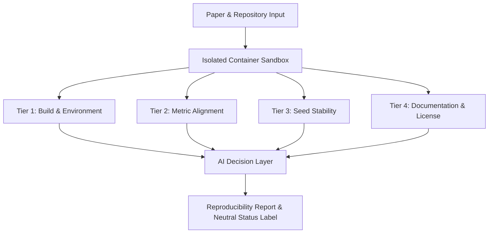

# Repro Radar 🛰️

[-blue.svg)](#)
[](#)
[](LICENSE)
[](docs/methodology.md)

**Repro Radar** is an automated replication and verification platform for empirical AI and machine learning papers. It tests paper-code pairs within isolated sandbox environments, generates a **4-Tier Reproducibility Score** (0–100), and automates verification diagnostics with an **AI Decision Layer**.

---

## 📌 Problem Statement

While scientific publication volume in artificial intelligence and machine learning is growing exponentially, independent capacity to verify and reproduce empirical claims has lagged critically behind.

- **Unpinned or Missing Dependencies:** Codebases break within months due to unversioned third-party libraries.
- **Cherry-Picked Random Seeds:** Claims holding true only under a single, undisclosed random seed.
- **Undocumented Environments:** Missing hardware or OS dependency declarations prevent clean compilation.
- **High Human Verification Overhead:** Reviewers and practitioners lack the isolated compute and time required to manually clone, configure, and re-run research repositories.

Repro Radar tackles this replication bottleneck with an **automated, transparent, and multi-tier** evaluation standard.

---

## 🏗️ System Architecture

The architecture is built on two primary pillars:



### 1. Four-Tier (4-Tier) Reproducibility Rubric

| Tier | Weight | Scope | Target Criteria |
| :--- | :---: | :--- | :--- |
| **Tier 1: Build & Execution** | **35%** | Repository cloning, dependency resolution, script entrypoint | Clean Exit Code 0 |
| **Tier 2: Metric Alignment** | **35%** | Claimed metrics vs reproduced outputs comparison | Relative Error $\le 5\%$ |
| **Tier 3: Seed Stability** | **15%** | Multi-seed stability & run-to-run variance | Coefficient of Variation (CV) |
| **Tier 4: Artifacts & License**| **15%** | Permissive OSI license, explicit environment files, logs | Open License Compliance |

### 2. AI Decision Layer & Neutral Language Principle

Repro Radar avoids subjective or punitive terminology. The AI Decision Layer inspects logs, execution traces, and metric differences to assign objective classifications:
- **`Verified`**: All tiers reproduced within tight tolerance bounds (Score $\ge 85$, Tier 1 $\ge 90$, Tier 2 $\ge 80$).
- **`Partially Verified`**: Code executed cleanly and the majority of claims aligned (Score $\ge 60$).
- **`Needs Review`**: Code compiled cleanly, but reproduced outputs diverged significantly from claims (suggesting hardware differences, dataset version mismatch, or unseeded stochastic operations).
- **`Failed`**: Compilation or fatal runtime errors prevented execution (Tier 1 $< 50$).

---

## 🚀 Quickstart & Local Setup

### Prerequisites
- Python 3.11 (3.10+ supported)
- Git
- Docker Engine / Docker Desktop to execute paper code. Without Docker, execution is refused unless you pass `--allow-unsafe-local` (see *Security, Isolation, & Ethical Standards* below). Docker is not needed to run the test suite.

For the full list of system tools, Python packages, sandbox image contents, environment variables, and verified fresh-machine setup steps, see [Environment & Dependency Inventory](docs/ENVIRONMENT.md).

### 1. Clone Repository & Navigate
```bash
git clone https://github.com/yusufkartal0009-eng/appendix_controller_for_articles.git
cd appendix_controller_for_articles
```

### 2. Create Virtual Environment & Install Dependencies
```bash
# Create virtual environment (on Windows, use `py -3.11 -m venv .venv` if `python` opens the Microsoft Store)
python -m venv .venv

# Activate environment (Windows PowerShell)
.venv\Scripts\Activate.ps1

# Activate environment (Linux/macOS)
# source .venv/bin/activate

# Development setup: runtime packages + tests, lint, and document tooling
pip install -r requirements-dev.txt

# Runtime only (no tests or lint)
# pip install -r requirements.txt
```

### 3. Initialize SQLite Database & Seed Papers
```bash
python cli.py init-db
```
This brings an existing database to the current schema (versioned migrations that keep its data; a copy of the file is made first, see `python scripts/migrate.py status`), executes `data/schema.sql` to initialize `data/repro_radar.db`, and loads the seed papers from `data/seed_papers.json` (see [Corpus Verification](docs/CORPUS_VERIFICATION.md) for what has and has not been checked).

### 4. List Curated Papers
```bash
python cli.py list-papers
```

### 5. Inspect Paper Details & Numerical Claims
```bash
python cli.py inspect paper_001
```

### 6. Score a Paper from a Real Run
```bash
python cli.py score paper_008                                  # runs the paper in the Docker sandbox, then scores it
python cli.py score paper_008 --from-run data/pilot2_runs/paper_008   # scores a stored run, no Docker
```

`cli.py score` runs the paper with its run setup (`run_setup` in `data/seed_papers.json`, the Pilot 2 flow of `scripts/run_pilot.py`), then scores the stored record and run report against the claims a person **accepted** (`python cli.py review-claims`). Datasets must already be in the cache (`scripts/fetch_data.py`). A claim is matched to the run's output by its question ID and is never guessed. A paper with no accepted claim gets the scorer's neutral Tier 2 baseline, and the output says so.

> **The `--simulate`, `--simulate-failure`, `--simulate-divergence`, `--simulate-build-error`, `--simulate-clone-error`, and `--simulate-deps-error` flags are a test aid.** They print `SIMULATION FOR TESTING`, make up the reproduced numbers from the claimed ones, and are never saved to the database.

### 7. Lint & Run Test Suite
```bash
ruff check .
pytest tests/ -v
```

---

## 🎯 Target Domain & Seed Dataset (`data/seed_papers.json`)

The seed domain is **"Tabular Machine Learning & Light NLP Benchmarks"**:
- **Frameworks:** TabPFN, FT-Transformer, TabR, FastSK, SAINT, DANets.
- **Dataset:** 6 entries in `data/seed_papers.json`. **6 of 6 entries pass `scripts/verify_corpus.py`** (paper link and title, repository, open license matching GitHub, target script present at a pinned commit); CI enforces this on every change. Whether the papers install and run was measured in Pilot 2 (`docs/PILOT_2.md`), and the numeric claims are the **12 claims** that were extracted from the papers' text and accepted one by one by the owner, in 5 of the 6 papers (`paper_005` has none); see [docs/CORPUS_VERIFICATION.md](docs/CORPUS_VERIFICATION.md). Most entries expect a GPU and download their datasets, so short CPU-only runs are not guaranteed.

---

## 🛡️ Security, Isolation, & Ethical Standards

1. **Sandboxed Execution:** External code runs in ephemeral containers with restricted CPU (2.0), memory (8GB), and complete network isolation (`--network none`). If Docker is unavailable, execution is refused (exit code 4). The only way to run paper code on the host is the explicit `--allow-unsafe-local` flag: **development only, and only for code you trust.** Such runs are marked `"isolated": false` in `run_report.json` and print a red warning. Real-Docker evidence for these guarantees: [docs/SANDBOX_ACCEPTANCE.md](docs/SANDBOX_ACCEPTANCE.md).
2. **Neutral Diagnostic Reporting:** When code fails to replicate claims, Repro Radar avoids accusatory language, providing detailed stack traces and assigning a `Needs Review` status.
3. **Open Licenses Only:** Only open source repositories (MIT, Apache-2.0, BSD, etc.) are evaluated.

For comprehensive security topology and container specifications, see [Sandbox Architecture & User Guide](docs/SANDBOX_GUIDE.md).

### Quick Sandbox Execution CLI

```bash
# Clone a research paper repository, bundle dependencies, and run in isolated sandbox
python scripts/stage_and_bundle_repo.py https://github.com/org/paper-repo.git \
    --paper-id paper_benchmark_01 \
    --script evaluate.py \
    --bundle-deps
```

---

## 📂 Directory Layout

```
repro-radar/
├── .dockerignore            # Limits the sandbox image build context
├── .gitignore               # Python, SQLite, venv, and cache rules
├── LICENSE                  # MIT License
├── README.md                # Project documentation
├── AGENTS.md                # Project conventions & projectflow operating rules
├── cli.py                   # CLI management & diagnostics tool
├── pyproject.toml           # Tool configuration (ruff lint gate)
├── requirements.txt         # Runtime dependencies
├── requirements-dev.txt     # Runtime + tests, lint, and document tooling
├── docker/
│   ├── Dockerfile.sandbox   # Hardened Python 3.11-slim container (non-root UID 1000)
│   ├── docker-compose.sandbox.yml # Compose isolation specs (read-only root, no network)
│   └── entrypoint.sh        # Timeout guard, log capture & execution_meta.json writer
├── scripts/
│   ├── stage_and_bundle_repo.py        # Repo cloning, dependency bundling & sandbox CLI
│   ├── verify_corpus.py                # Checks seed entries: paper, repo, license, pinned script
│   ├── sandbox_acceptance.py           # Real-Docker sandbox acceptance checks (run in CI)
│   ├── hash_run.py                     # SHA-256 manifest of a run directory; verify and compare runs (#29)
│   ├── generate_academic_introduction_doc.py # Builds the introduction draft (.docx, not committed)
│   ├── setup_github_backlog.py         # Provisions labels, milestones & backlog issues
│   ├── setup_7week_board.py            # Provisions the weekly tracking board
│   └── setup_github_board.sh           # Shell variant of the board provisioning
├── src/
│   ├── __init__.py          # Package init
│   ├── config.py            # Paths, tier weights, and tolerances
│   ├── artifact_hash.py     # SHA-256 manifests of run directories (integrity and reproducibility hashes)
│   ├── database.py          # SQLite engine, sessions, init, and seeding
│   ├── migrations.py        # Versioned schema migrations for existing databases (#12)
│   ├── models.py            # Pydantic and SQLAlchemy ORM schemas
│   ├── scoring.py           # 4-Tier scoring engine and AI decision layer
│   ├── metric_extractor.py  # Metric parsing from logs, JSON, and sklearn reports
│   └── sandbox/
│       ├── __init__.py      # Sandbox package exports
│       ├── runner.py        # DockerSandboxRunner; opt-in unisolated ProcessSandboxRunner
│       └── stager.py        # RepoStager & DependencyManifest parser
├── data/
│   ├── schema.sql           # SQLite DDL schema
│   └── seed_papers.json     # Seed corpus (checked by scripts/verify_corpus.py)
├── docs/
│   ├── BLUEPRINT.md         # Master project blueprint and milestone gates
│   ├── ARCHITECTURE.md      # System constraints, components, and contracts
│   ├── PROGRESS.md          # Continuous living progress memory
│   ├── STACK.md             # Technology stack and security boundaries
│   ├── ENVIRONMENT.md       # System tools, dependencies & fresh-machine setup
│   ├── SANDBOX_GUIDE.md     # Sandbox architecture, security specs & CLI guide
│   ├── gap_analysis.md      # Known gaps, evidence, and remediation status
│   ├── CORPUS_VERIFICATION.md # Per-entry corpus checks and what remains unverified
│   ├── SANDBOX_ACCEPTANCE.md  # Real-Docker evidence of sandbox isolation
│   ├── DECISIONS.md           # Security-relevant decisions with risks and evidence
│   ├── methodology.md       # Reproducibility scoring rubric and formulas
│   ├── project_roadmap.md   # 7-week detailed roadmap
│   └── assets/              # Images used by the docs (the generated banner is not committed)
└── tests/
    ├── __init__.py
    ├── test_academic_doc.py        # Introduction document generator tests
    ├── test_database.py            # Database schema and seeding tests
    ├── test_metric_extractor.py    # Log, JSON, and sklearn metric parsing tests
    ├── test_models.py              # Validation and schema tests
    ├── test_sandbox.py             # Container isolation & runner tests
    ├── test_scoring.py             # Tier 1-4 rubric and decision rules tests
    ├── test_seed.py                # Seed dataset completeness tests
    ├── test_setup_github_backlog.py # Backlog script command-safety tests
    ├── test_stager.py              # Staging, dependency analysis & execution report tests
    └── test_verify_corpus.py       # Corpus verifier tests (offline, fake HTTP)
```

---

## 📄 License

Distributed under the [MIT License](LICENSE).
