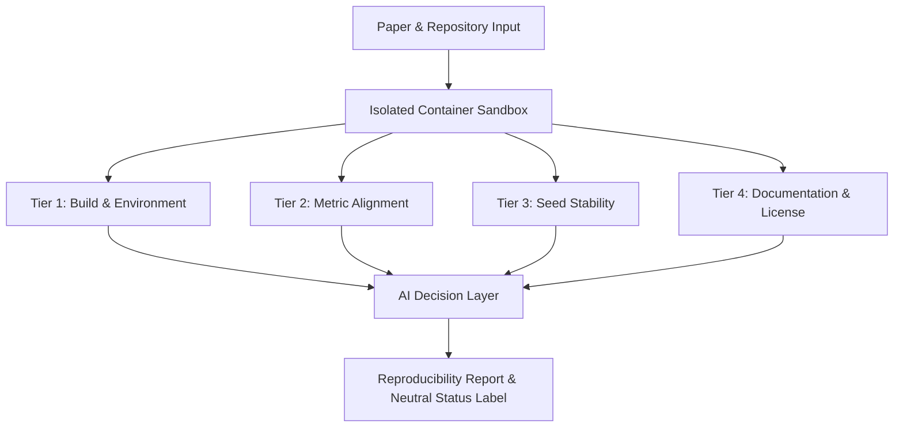

# Repro Radar 🛰️

[](#)
[](#)
[](LICENSE)
[](docs/methodology.md)

**Repro Radar** is an automated replication and verification platform for empirical AI and machine learning papers. It tests paper-code pairs within isolated sandbox environments, generates a **4-Tier Reproducibility Score** (0–100), and automates verification diagnostics with an **AI Decision Layer**.

---

## 📍 Current Status (2026-10-28)

- **Built and checked:** the Docker sandbox (its isolation was checked against a real Docker daemon in CI while a workflow existed (removed in #388, D-010), [`docs/SANDBOX_ACCEPTANCE.md`](docs/SANDBOX_ACCEPTANCE.md)), the corpus verification, claim extraction with a verbatim-quote guard and a person's review of every claim, `cli.py score` for a stored or a fresh real run, and a local dashboard.
- **Pilots:** four pilots ran 12 papers in total ([`docs/report/REPORT.md`](docs/report/REPORT.md) section 6, [`docs/FIELD_ANALYSIS.md`](docs/FIELD_ANALYSIS.md)). The success rate is low, and the run setups of Pilots 2 and 3 were written by us (see *What a Result Means* below).
- **Tier 3 (seed stability) now runs real seed runs** (#48, [`docs/MULTI_SEED.md`](docs/MULTI_SEED.md)): `paper_003` and `paper_006` were run with three seeds each (`data/multi_seed_runs/`, not protocol runs). `cli.py score` and the dashboard database read these records (#542): the metric that an accepted claim is mapped to decides Tier 3 (default chosen by the assistant, the owner may revise), so Tier 3 is 100.0 for `paper_003` (the claimed RMSE has a CV of 0.70 %; the largest-CV rule, which a training loss of 7.4 % would have decided, gave 65.0) and 100.0 for `paper_006` (no accepted claim has a counterpart, so the largest-CV rule applies). A paper without a record keeps the 75.0 single-run baseline.
- **AI Decision Layer:** implemented as a rule-based diagnosis (`python cli.py diagnose <run directory>`, [`docs/DIAGNOSIS.md`](docs/DIAGNOSIS.md)). An optional language-model step is off by default and was tested only with a mock client, never with a real model.
- **GPU:** opt-in (`--gpus all`). One synthetic paper with a modern PyTorch ran on the RTX 5070 through the real pipeline (`data/gpu_check/`); no real paper was run with the GPU.
- **Automatic search (2026-10-25):** **0 of 135** candidates of the automatic search of round 3 passed both the run test and the match of the output to the paper's text (K1 passed by 2 of 135, K2 by 0 of 135; Wilson 95 % intervals in the report, section 6.10); a selected, non-representative list, not a success rate ([`docs/AUTO_SEARCH_ROUND3.md`](docs/AUTO_SEARCH_ROUND3.md), section 10; no claim accepted).
- **Automatic search, round 4 (2026-10-27):** **0 of 107** candidates passed both the run test (K1) and a match of the output to the paper's text (K1 passed by 3 of 107; K2 v1 and the new K2 v2, which also reads a fraction as a percent and rounds, each by 1 of 107, a fuzzing script that failed K1 and matched integers by chance); a selected, non-representative list, not a success rate ([`docs/AUTO_SEARCH_ROUND4.md`](docs/AUTO_SEARCH_ROUND4.md), section 11; report section 6.10a; no claim accepted).
- **Night of 2026-10-28:** Tier 3 is bound to the stored multi-seed records and the claimed metric (#542), the dashboard gives the reason of every label (#548, screenshots in [`docs/evidence/demo3/`](docs/evidence/demo3/)), the report is in its final text apart from the owner's inputs ([`docs/PAPER_STATUS.md`](docs/PAPER_STATUS.md)), and three open questions got defaults that the owner may revise ([`docs/PENDING.md`](docs/PENDING.md), K-A, K-B, K-C). A PDF of the report could not be produced (no converter on the machine: not verified).
- **Why runs failed (2026-10-28):** [`docs/FAILURE_STATISTICS.md`](docs/FAILURE_STATISTICS.md) counts the first failure of every stored run by simple text rules (Pilots 1-4, the candidate list, the automatic searches of rounds 3 and 4), generated by `python scripts/failure_statistics.py` (`--check` verifies it). The lists are selected, not sampled: these are counts of why selected runs failed, not a success rate.
- **Decisions on real runs (2026-10-25):** [`docs/REAL_VERDICTS.md`](docs/REAL_VERDICTS.md) puts every completed stored run next to the accepted claims and shows what the scorer decides. Before the claim map the claims (keyed by question ID) never matched the run's metrics, so Tier 2 was 0 for a real paper; since #507 and #509 `cli.py score` pairs them through [`data/claim_metric_map.json`](data/claim_metric_map.json) ([`docs/CLAIM_METRIC_MAP.md`](docs/CLAIM_METRIC_MAP.md); a proposal the owner may revise): 1 of the 13 accepted claims is compared (`paper_003`: 0.459 against 0.473, 3.05 % apart, Tier 2 100, `Verified`; one claim and one number, close but not equal), the other 12 have no counterpart in the stored runs and leave Tier 2, and the check that a run's numbers occur in the paper (K2) has no real positive control yet. The synthetic control is the only row with a known answer. [`docs/PAPER_STATUS.md`](docs/PAPER_STATUS.md) says which parts of the report are final and what waits for the owner.
- **Dashboard with real data:** `python scripts/build_demo_db.py`, then `python -m src.web --db-url sqlite:///data/dashboard_demo.db` (see *Open the Local Dashboard*; screenshots in [`docs/evidence/demo2/`](docs/evidence/demo2/)).
- **Bug hunt, second pass (2026-10-25):** of the seven suspicions in [`docs/BUG_HUNT.md`](docs/BUG_HUNT.md), three were real bugs and are fixed (quote guard value match, classifier path rule, README at the pinned commit), one (the dashboard showing another run beside a score) was real and is fixed in #513, and three are owner decisions.
- **Since 2026-10-20:** the six sandbox images were rebuilt from scratch and timed ([`docs/ENVIRONMENT.md`](docs/ENVIRONMENT.md)); a clone of the public repository followed this README to a completed run of `paper_006` (2,490 s, [`docs/evidence/clean_clone/WALKTHROUGH.md`](docs/evidence/clean_clone/WALKTHROUGH.md) Update 2); of the 14 candidate papers that the owner's lists call ready or fixable, **0 passed** a single run each under a protocol written before the runs ([`docs/CANDIDATE_RUNS.md`](docs/CANDIDATE_RUNS.md), [`docs/CANDIDATES.md`](docs/CANDIDATES.md); a selected list, not a success rate), and **1 of the 14 passed after repair** in a separate repair round ([`docs/CANDIDATE_RUNS_ROUND2.md`](docs/CANDIDATE_RUNS_ROUND2.md); its output matches no table of its paper, and no claim is accepted); a tolerance probe moves hand-made claims away from the values of real runs ([`docs/TOLERANCE_PROBE.md`](docs/TOLERANCE_PROBE.md); not an error of a real paper, and the real-world false-positive and false-negative rates have not been measured); a demo script uses only examples with evidence ([`docs/DEMO_SCRIPT.md`](docs/DEMO_SCRIPT.md)); a bug hunt fixed three bugs and listed seven suspicions ([`docs/BUG_HUNT.md`](docs/BUG_HUNT.md)). Open decisions: [`docs/PENDING.md`](docs/PENDING.md).
- **Not done:** no run has been shown to reproduce an accepted claim (the one close case, `paper_003`, is one claim and one number), so Tier 2 has not been exercised on a confirmed real result; no release is tagged (#45); the selection of external reference articles from ReScience C found none usable ([`docs/EXTERNAL_VALIDATION.md`](docs/EXTERNAL_VALIDATION.md)).

---

## 📌 Problem Statement

While scientific publication volume in artificial intelligence and machine learning is growing exponentially, independent capacity to verify and reproduce empirical claims has lagged critically behind.

- **Unpinned or Missing Dependencies:** Codebases break within months due to unversioned third-party libraries.
- **Cherry-Picked Random Seeds:** Claims holding true only under a single, undisclosed random seed.
- **Undocumented Environments:** Missing hardware or OS dependency declarations prevent clean compilation.
- **High Human Verification Overhead:** Reviewers and practitioners lack the isolated compute and time required to manually clone, configure, and re-run research repositories.

Repro Radar tackles this replication bottleneck with an **automated, transparent, and multi-tier** evaluation standard.

---

## 🏗️ System Architecture

The architecture is built on two primary pillars:



### 1. Four-Tier (4-Tier) Reproducibility Rubric

| Tier | Weight | Scope | Target Criteria |
| :--- | :---: | :--- | :--- |
| **Tier 1: Build & Execution** | **35%** | Repository cloning, dependency resolution, script entrypoint | Clean Exit Code 0 |
| **Tier 2: Metric Alignment** | **35%** | Claimed metrics vs reproduced outputs comparison | Relative Error $\le 5\%$ |
| **Tier 3: Seed Stability** | **15%** | Multi-seed stability & run-to-run variance | Coefficient of Variation (CV) |
| **Tier 4: Artifacts & License**| **15%** | Permissive OSI license, explicit environment files, logs | Open License Compliance |

### 2. AI Decision Layer & Neutral Language Principle

Repro Radar avoids subjective or punitive terminology. The AI Decision Layer inspects logs, execution traces, and metric differences to assign objective classifications:
- **`Verified`**: All tiers reproduced within tight tolerance bounds (Score $\ge 85$, Tier 1 $\ge 90$, Tier 2 $\ge 80$).
- **`Partially Verified`**: Code executed cleanly and the majority of claims aligned (Score $\ge 60$). At least one accepted claim must have been compared with a metric of the run; a run with nothing to compare is `Needs Review`.
- **`Needs Review`**: Code compiled cleanly, but reproduced outputs diverged significantly from claims (suggesting hardware differences, dataset version mismatch, or unseeded stochastic operations), or no accepted claim could be compared with the run.
- **`Failed`**: Compilation or fatal runtime errors prevented execution (Tier 1 $< 50$).

In this repository the layer is **rule-based**: it classifies a failure with the categories of Pilot 1, writes a report in which every sentence names the file and key it was read from, writes "unknown" for a value the files do not hold, names no cause beyond the quoted log line, and explains the difference between two runs without naming a cause either ([`docs/DIAGNOSIS.md`](docs/DIAGNOSIS.md), examples in [`docs/DIAGNOSIS_EXAMPLES.md`](docs/DIAGNOSIS_EXAMPLES.md) and [`docs/DIAGNOSIS_COMPARISONS.md`](docs/DIAGNOSIS_COMPARISONS.md)). The classifier was checked against labels written by hand ([`docs/DIAGNOSIS_VALIDATION.md`](docs/DIAGNOSIS_VALIDATION.md)); the statuses above are assigned by the scorer, not by the diagnosis.

---

## 🚀 Quickstart & Local Setup

### Prerequisites
- Python 3.11 (3.10+ supported)
- Git
- Docker Engine / Docker Desktop to execute paper code. Without Docker, execution is refused unless you pass `--allow-unsafe-local` (see *Security, Isolation, & Ethical Standards* below). Docker is not needed to run the test suite.

For the full list of system tools, Python packages, sandbox image contents, environment variables, and verified fresh-machine setup steps, see [Environment & Dependency Inventory](docs/ENVIRONMENT.md).

### 1. Clone Repository & Navigate
```bash
git clone https://github.com/yusufkartal0009-eng/appendix_controller_for_articles.git
cd appendix_controller_for_articles
```

### 2. Create Virtual Environment & Install Dependencies
```bash
# Create virtual environment (on Windows, use `py -3.11 -m venv .venv` if `python` opens the Microsoft Store)
# On Windows keep the path of the clone short (for example `C:\src`): in a clone under a 174-character path `python -m venv` failed with
# an `ensurepip` error (long paths were disabled on that machine; the cause was not tested further)
python -m venv .venv

# Activate environment (Windows PowerShell)
.venv\Scripts\Activate.ps1

# Activate environment (Linux/macOS)
# source .venv/bin/activate

# Development setup: runtime packages + tests, lint, and document tooling
pip install -r requirements-dev.txt

# Runtime only (no tests or lint)
# pip install -r requirements.txt
```

### 3. Initialize SQLite Database & Seed Papers
```bash
python cli.py init-db
```
This brings an existing database to the current schema (versioned migrations that keep its data; a copy of the file is made first, see `python scripts/migrate.py status`), executes `data/schema.sql` to initialize `data/repro_radar.db`, and loads the seed papers from `data/seed_papers.json` (see [Corpus Verification](docs/CORPUS_VERIFICATION.md) for what has and has not been checked).

### 4. List Curated Papers
```bash
python cli.py list-papers
```

### 5. Inspect Paper Details & Numerical Claims
```bash
python cli.py inspect paper_003
```

### 6. Build the Sandbox Image (one time)
```bash
docker build -f docker/Dockerfile.sandbox -t repro-radar-sandbox:latest .
```
The sandbox image is built on your machine; it is not downloaded from anywhere, so without this step the first run stops with `pull access denied for repro-radar-sandbox`. `cli.py score` runs a preflight check first (`python scripts/preflight.py` runs it alone) and, if the image is missing, prints this command.

Some papers need more images. Build them when a run asks for them (the commands follow `docker/Dockerfile.sandbox`; all six images were built from scratch with these commands on 2026-10-24, each exit code 0, 43 to 90 s per image; the table is in `docs/ENVIRONMENT.md`, #435):

```bash
# compiler image, used by the build phase when a paper's dependencies must be compiled
docker build -f docker/Dockerfile.sandbox --target build -t repro-radar-sandbox:build .
# Python 3.8 and 3.9 papers (replace 3.8 by 3.9 for the second); the -build image is the compiler image of that version
docker build -f docker/Dockerfile.sandbox --build-arg PYTHON_VERSION=3.8 -t repro-radar-sandbox:py3.8 .
docker build -f docker/Dockerfile.sandbox --build-arg PYTHON_VERSION=3.8 --target build -t repro-radar-sandbox:py3.8-build .
```

### 7. Score a Paper from a Real Run
```bash
python cli.py score paper_008                                  # runs the paper in the Docker sandbox, then scores it
python cli.py score paper_008 --from-run data/pilot2_runs/paper_008   # scores a stored run, no Docker
```

Options of `cli.py score`: `--memory` (container memory: a size such as `8g`, or a share of the host's RAM; default `50%`), `--cpus N` (default 2), `--timeout SECONDS` (time limit of the run phase, default 3600; a run with a changed limit is not a protocol run and its record says so), `--from-run DIR` (score a stored run, no Docker), `--data-cache` and `--staging-dir`. A preflight check runs before every real run (Docker answers, the sandbox image exists, disk and memory, a container starts); A real run writes its record to `sandbox_runs/score/<paper_id>`; if that folder already holds an earlier run, `cli.py score` stops instead of overwriting the evidence: move the folder to `sandbox_runs/score/first_attempts/` (or delete it if you do not need it) and run again.

> **Read this before your first real run.** In a clean-clone test (`docs/evidence/clean_clone/WALKTHROUGH.md`) neither fresh run below produced a score worth showing: `paper_008` needs a dataset that is downloaded by hand and stops after 38 s (status Failed, expected); `paper_006` (`python scripts/fetch_data.py paper_006` first) was still training when the 3,600 s run limit killed it (issue #396). `python cli.py init-db` loads the claims that the owner accepted from `data/claims/review_decisions.json` (13 claims), so `cli.py score` uses them. To see the scorer work without a long run, score a stored run: `python cli.py score paper_006 --from-run data/pilot3_runs/paper_006`. Its claims concern the Arcene dataset while the run setup trains on another one, so neither claim has a counterpart in the run: Tier 2 is the neutral baseline of 70, the total is 86.5 and the label is `Needs Review` (verified in a clean clone on 2026-10-28, `docs/evidence/clean_clone2/WALKTHROUGH.md`), a known limit of that paper's run setup (`docs/report/REPORT.md` section 6.3; the same table for every stored run is in `docs/REAL_VERDICTS.md`).

`cli.py score` runs the paper with its run setup (`run_setup` in `data/seed_papers.json`, the Pilot 2 flow of `scripts/run_pilot.py`), then scores the stored record and run report against the claims a person **accepted** (`python cli.py review-claims`). Datasets must already be in the cache (`scripts/fetch_data.py`). A claim is matched to the run's output by its question ID and is never guessed. A paper with no accepted claim gets the scorer's neutral Tier 2 baseline, and the output says so.

> **The `--simulate`, `--simulate-failure`, `--simulate-divergence`, `--simulate-build-error`, `--simulate-clone-error`, and `--simulate-deps-error` flags are a test aid.** They print `SIMULATION FOR TESTING`, make up the reproduced numbers from the claimed ones, and are never saved to the database.

### 7a. Explain a Run, or Run a Paper with Several Seeds
```bash
python cli.py diagnose data/pilot3_runs/paper_004              # a stored run explained from its files only (add --json for JSON)
python scripts/run_multi_seed.py paper_006 --pilot3 --memory 50% --cpus 4   # one real run per seed (Tier 3, needs Docker)
python scripts/field_analysis.py --check                       # the week 6 field analysis equals the stored records
```
`diagnose` calls no model and no network. `run_multi_seed.py` uses the paper's own seed parameter (`data/multi_seed_settings.json`; a paper without one is not run) and stores one record per seed under `data/multi_seed_runs/<paper_id>/`.

### 8. Lint & Run Test Suite
```bash
ruff check .
pytest tests/ -v
```

### 9. Open the Local Dashboard
```bash
python -m src.web                  # http://127.0.0.1:8000 (use --port to change it)
```
To see the dashboard with the real stored runs instead of an empty database, build a separate database file and start the
dashboard on it (the project database `data/repro_radar.db` is not touched, and `data/dashboard_demo.db` is not committed):
```bash
python scripts/build_demo_db.py
python -m src.web --db-url sqlite:///data/dashboard_demo.db
```
The script scores every stored run with the accepted claims and keeps the best record of each paper; the score's summary says
which run and setting it is. It also stores the reasons of every score (table `score_explanations`, created when the first one is saved), which the pages below show. Screenshots of the final dashboard: [`docs/evidence/demo3/`](docs/evidence/demo3/) (earlier: [`demo2/`](docs/evidence/demo2/)).

The dashboard runs on **localhost only** (`127.0.0.1`, `docs/DECISIONS.md` D-006) and reads the project database (`data/repro_radar.db`, created by `cli.py init-db`); it never shows a number that is not stored there. Use `--db-url` to point it at another SQLAlchemy database.

| Address | What it shows |
|---|---|
| `/` | The leaderboard: one table with search (title, venue), a status filter, and sorting by paper, year, or score. Beside each label a short reason (claim compared yes/no; Tier 2 "baseline, nothing compared"). Papers without a stored score are listed last as "Not scored". The synthetic control is listed apart as "not a paper: known-answer control". |
| `/papers/{paper_id}` | One paper: its score breakdown, "Why this label" (claims compared and not compared with reasons, the tolerance rule, the difference in percent, where Tier 3 came from, the stored run, a failure category with the log line), its run with the end of the logs, and download links for the report. |
| `/failures` | The failure statistics from `data/failure_statistics.json` (`scripts/failure_statistics.py`), with the selection-bias warning. Stored numbers only; not a success rate. |
| `/api/v1/papers`, `/api/v1/scores`, `/api/v1/scores/{paper_id}`, `/api/v1/runs/{run_id}` | The same data as JSON. The interactive documentation is at `/docs`. |
| `/api/v1/badges/{paper_id}.svg` | An embeddable SVG badge with the stored score and status, or a gray "not scored" badge. |
| `/api/v1/papers/{paper_id}/report.md` and `.pdf` | The audit report of one paper as a Markdown or PDF download. |

**Empty states.** With no papers loaded the page says so and names the command to run (`python cli.py init-db`). A paper that has no score shows "Not scored", a paper that has not been run says so, and an unknown ID gives a 404. Seed claim values are hand-typed and unverified, so the dashboard never shows them.

**Screenshots and samples** (a throwaway demo database with invented numbers is labeled as such, and is not a result): [`docs/evidence/d2/`](docs/evidence/d2/) (pages), [`d3/`](docs/evidence/d3/) (badges), [`d4/`](docs/evidence/d4/) (reports), [`d1/`](docs/evidence/d1/) (`curl` output). The report numbers are described in [`docs/report/REPORT.md`](docs/report/REPORT.md).

---

## 🧰 Requirements

| What | Need | Where it comes from |
|---|---|---|
| Python, Git | Python 3.11 (3.10+ for the tests), Git | |
| Docker | Docker Desktop or Engine that starts containers; on Windows with WSL2 it gets about half of the machine's RAM by default (15.5 GiB on a 32 GB machine) | `scripts/preflight.py` reads it |
| RAM | 32 GB is what the heavy pilots were run on; 16 GB should cover light papers (my estimate, not tested). In the pilots `paper_004` peaked at 10.6 GiB; `paper_005` was killed for memory even at 13.9 GiB. | `docs/MEMORY_RUNS.md` |
| Disk | At least 30 GB free (the preflight warns below that). The six sandbox images are 0.6 to 1.2 GB each (629 MB to 1.15 GB). | `scripts/preflight.py`, `docker images` |
| Time | A tiny paper runs in seconds (`paper_102`: 12.7 s run). The two strongest examples take minutes: `paper_006` about 19 min on 8 CPUs, `paper_003` about 25 min for the run alone (the whole run, with staging and install, took about 44 min cold and about 26 min with a warm environment cache); `paper_004` took about 2.5 h. | `docs/CPU_RUNS.md`, `docs/MEMORY_RUNS.md`, `docs/ENV_CACHE_RUNS.md` |
| Network | Needed to clone repositories and download wheels and datasets *before* a run; the run itself has no network | `docs/SANDBOX_GUIDE.md` |
| GPU | Not needed; opt-in only (`docs/ENVIRONMENT.md`) | |

Times are from one machine (Windows, 8 CPUs given to Docker) and are not guarantees.

## 🔍 What a Result Means (and What It Does Not)

- **The strongest evidence** is two papers, `paper_003` and `paper_006`: each reproduced identical metrics in 4 runs (`docs/STABILITY_RUNS.md`), and a synthetic control paper with a known true and a known false claim scored as it should (`scripts/synthetic_control.py`, `data/synthetic_control/`).
- **The overall success rate is low.** Pilot 4 took six *new* papers with the command from their README as it stands: pilot success **1 of 6** (install 2 of 6, 3 of 6 after one correction round; run 2 of 6). Pilot 3 (2 of 6) used settings chosen after the failures of Pilots 1 and 2, so it measures the settings, not new papers. Details: `data/pilot4_runs/summary.md`.
- **Repro Radar does not verify every paper.** Most failures are missing dependencies, data that is not available offline, and memory or time limits. A failure is reported with its category and the log line, in neutral words, and it says nothing about the authors.
- **A score is only as good as the claims behind it.** Only claims a person accepted are scored, and a paper without an accepted claim gets a neutral baseline for the metric tier and the output says so. A run that "completes" can still run something other than the paper's main experiment (the README command may be a demo).

---

## 🎯 Target Domain & Seed Dataset (`data/seed_papers.json`)

The seed domain is **"Tabular Machine Learning & Light NLP Benchmarks"**:
- **Frameworks:** TabPFN, FT-Transformer, TabR, FastSK, SAINT, DANets.
- **Dataset:** 6 entries in `data/seed_papers.json`. **6 of 6 entries pass `scripts/verify_corpus.py`** (paper link and title, repository, open license matching GitHub, target script present at a pinned commit); run it yourself with `python scripts/verify_corpus.py` (there is no CI service, `docs/DECISIONS.md` D-010; checks run locally). Whether the papers install and run was measured in Pilot 2 (`docs/PILOT_2.md`), and the numeric claims are the **13 claims** that were extracted from the papers' text and accepted one by one by the owner, in all 6 papers (`paper_005` has one, a follow-up question); see [docs/CORPUS_VERIFICATION.md](docs/CORPUS_VERIFICATION.md). Most entries expect a GPU and download their datasets, so short CPU-only runs are not guaranteed.

---

## 🛡️ Security, Isolation, & Ethical Standards

1. **Sandboxed Execution:** External code runs in ephemeral containers with restricted CPU (2.0 by default), memory, and complete network isolation (`--network none`). The memory limit of a `cli.py score` run is 50% of the host's RAM by default (capped at 90% of what Docker can see; `--memory 8g` sets a fixed size). The library default (`SandboxConfig`) is 8 GB. If Docker is unavailable, execution is refused (exit code 4). The only way to run paper code on the host is the explicit `--allow-unsafe-local` flag: **development only, and only for code you trust.** Such runs are marked `"isolated": false` in `run_report.json` and print a red warning. Real-Docker evidence for these guarantees: [docs/SANDBOX_ACCEPTANCE.md](docs/SANDBOX_ACCEPTANCE.md).
2. **Neutral Diagnostic Reporting:** When code fails to replicate claims, Repro Radar avoids accusatory language, providing detailed stack traces and assigning a `Needs Review` status.
3. **Open Licenses Only:** Only open source repositories (MIT, Apache-2.0, BSD, etc.) are evaluated.

For comprehensive security topology and container specifications, see [Sandbox Architecture & User Guide](docs/SANDBOX_GUIDE.md).

### Quick Sandbox Execution CLI

```bash
# Clone a research paper repository, bundle dependencies, and run in isolated sandbox
python scripts/stage_and_bundle_repo.py https://github.com/org/paper-repo.git \
    --paper-id paper_benchmark_01 \
    --script evaluate.py \
    --bundle-deps
```

---

## 📂 Directory Layout

```
repro-radar/
├── .dockerignore            # Limits the sandbox image build context
├── .gitignore               # Python, SQLite, venv, and cache rules
├── LICENSE                  # MIT License
├── README.md                # Project documentation
├── AGENTS.md                # Project conventions & projectflow operating rules
├── cli.py                   # CLI management & diagnostics tool
├── pyproject.toml           # Tool configuration (ruff lint gate)
├── requirements.txt         # Runtime dependencies
├── requirements-dev.txt     # Runtime + tests, lint, and document tooling
├── docker/
│   ├── Dockerfile.sandbox   # Hardened Python 3.11-slim container (non-root UID 1000)
│   ├── docker-compose.sandbox.yml # Compose isolation specs (read-only root, no network)
│   └── entrypoint.sh        # Timeout guard, log capture & execution_meta.json writer
├── scripts/
│   ├── stage_and_bundle_repo.py        # Repo cloning, dependency bundling & sandbox CLI
│   ├── verify_corpus.py                # Checks seed entries: paper, repo, license, pinned script
│   ├── sandbox_acceptance.py           # Real-Docker sandbox acceptance checks (run locally; CI was removed, D-010)
│   ├── hash_run.py                     # SHA-256 manifest of a run directory; verify and compare runs (#29)
│   ├── run_multi_seed.py               # One real sandbox run per seed; summary and Tier 3 (#48)
│   ├── field_analysis.py               # Week 6 analysis over 12 papers: rates, autonomy, descriptive factors (#413)
│   ├── gpu_paper_check.py              # Synthetic paper with a modern PyTorch run with the local GPU (#169)
│   ├── evaluate_diagnosis_classifier.py # Classifier against hand-written labels (#36)
│   ├── generate_academic_introduction_doc.py # Builds the introduction draft (.docx, not committed)
│   ├── setup_github_backlog.py         # Provisions labels, milestones & backlog issues
│   ├── setup_7week_board.py            # Provisions the weekly tracking board
│   └── setup_github_board.sh           # Shell variant of the board provisioning
├── src/
│   ├── __init__.py          # Package init
│   ├── config.py            # Paths, tier weights, and tolerances
│   ├── artifact_hash.py     # SHA-256 manifests of run directories (integrity and reproducibility hashes)
│   ├── database.py          # SQLite engine, sessions, init, and seeding
│   ├── migrations.py        # Versioned schema migrations for existing databases (#12)
│   ├── models.py            # Pydantic and SQLAlchemy ORM schemas
│   ├── scoring.py           # 4-Tier scoring engine and decision rules (Tier 3 from seed runs: multi_seed.py)
│   ├── multi_seed.py        # Seed spec, applying a seed to a run setup, per-metric seed summary (#48)
│   ├── diagnosis/           # Rule-based diagnosis: schema, classifier, report, run comparison, optional model backends
│   ├── metric_extractor.py  # Metric parsing from logs, JSON, and sklearn reports
│   ├── web/                 # Local dashboard: API routes, pages, badges, report export (python -m src.web)
│   └── sandbox/
│       ├── __init__.py      # Sandbox package exports
│       ├── runner.py        # DockerSandboxRunner; opt-in unisolated ProcessSandboxRunner
│       └── stager.py        # RepoStager & DependencyManifest parser
├── data/
│   ├── schema.sql           # SQLite DDL schema
│   ├── seed_papers.json     # Seed corpus (checked by scripts/verify_corpus.py)
│   ├── multi_seed_settings.json # The seed parameters of the seed papers (#48)
│   └── pilot*_runs/, multi_seed_runs/, field_analysis/, diagnosis_validation/, gpu_check/  # Stored records and results
├── docs/
│   ├── BLUEPRINT.md         # Master project blueprint and milestone gates
│   ├── ARCHITECTURE.md      # System constraints, components, and contracts
│   ├── PROGRESS.md          # Continuous living progress memory
│   ├── STACK.md             # Technology stack and security boundaries
│   ├── ENVIRONMENT.md       # System tools, dependencies & fresh-machine setup
│   ├── SANDBOX_GUIDE.md     # Sandbox architecture, security specs & CLI guide
│   ├── gap_analysis.md      # Known gaps, evidence, and remediation status
│   ├── CORPUS_VERIFICATION.md # Per-entry corpus checks and what remains unverified
│   ├── SANDBOX_ACCEPTANCE.md  # Real-Docker evidence of sandbox isolation
│   ├── DECISIONS.md           # Security-relevant decisions with risks and evidence
│   ├── methodology.md       # Reproducibility scoring rubric and formulas
│   ├── MULTI_SEED.md, DIAGNOSIS.md, FIELD_ANALYSIS.md # Tier 3 design, diagnosis layer, week 6 analysis
│   ├── report/REPORT.md     # The final report (its numbers are generated: scripts/report_numbers.py)
│   ├── project_roadmap.md   # 7-week detailed roadmap
│   └── assets/              # Images used by the docs (the generated banner is not committed)
└── tests/
    ├── __init__.py
    ├── test_academic_doc.py        # Introduction document generator tests
    ├── test_database.py            # Database schema and seeding tests
    ├── test_metric_extractor.py    # Log, JSON, and sklearn metric parsing tests
    ├── test_models.py              # Validation and schema tests
    ├── test_sandbox.py             # Container isolation & runner tests
    ├── test_scoring.py             # Tier 1-4 rubric and decision rules tests
    ├── test_seed.py                # Seed dataset completeness tests
    ├── test_setup_github_backlog.py # Backlog script command-safety tests
    ├── test_stager.py              # Staging, dependency analysis & execution report tests
    └── test_verify_corpus.py       # Corpus verifier tests (offline, fake HTTP)
```

---

## 📄 License

Distributed under the [MIT License](LICENSE).
