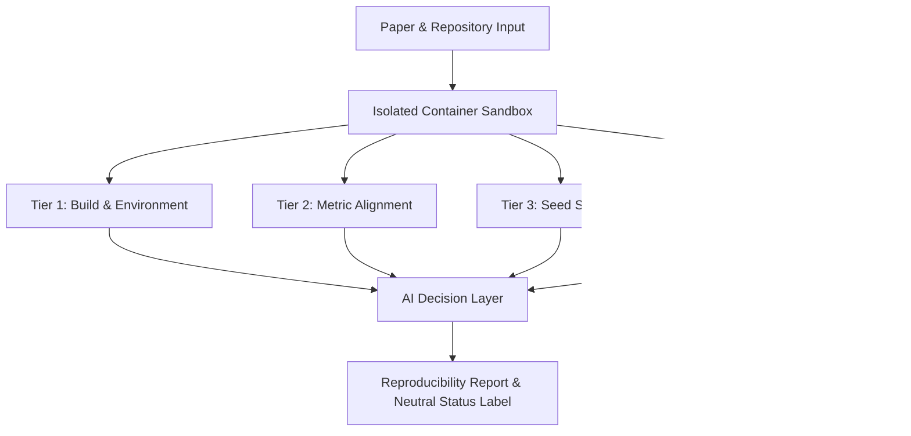

# Repro Radar 🛰️

[-blue.svg)](#)
[](#)
[](LICENSE)
[](docs/methodology.md)

**Repro Radar** is an automated replication and verification platform for empirical AI and machine learning papers. It tests paper-code pairs within isolated sandbox environments, generates a **4-Tier Reproducibility Score** (0–100), and automates verification diagnostics with an **AI Decision Layer**.

---

## 📌 Problem Statement

While scientific publication volume in artificial intelligence and machine learning is growing exponentially, independent capacity to verify and reproduce empirical claims has lagged critically behind.

- **Unpinned or Missing Dependencies:** Codebases break within months due to unversioned third-party libraries.
- **Cherry-Picked Random Seeds:** Claims holding true only under a single, undisclosed random seed.
- **Undocumented Environments:** Missing hardware or OS dependency declarations prevent clean compilation.
- **High Human Verification Overhead:** Reviewers and practitioners lack the isolated compute and time required to manually clone, configure, and re-run research repositories.

Repro Radar tackles this replication bottleneck with an **automated, transparent, and multi-tier** evaluation standard.

---

## 🏗️ System Architecture

The architecture is built on two primary pillars:



### 1. Four-Tier (4-Tier) Reproducibility Rubric

| Tier | Weight | Scope | Target Criteria |
| :--- | :---: | :--- | :--- |
| **Tier 1: Build & Execution** | **35%** | Repository cloning, dependency resolution, script entrypoint | Clean Exit Code 0 |
| **Tier 2: Metric Alignment** | **35%** | Claimed metrics vs reproduced outputs comparison | Relative Error $\le 5\%$ |
| **Tier 3: Seed Stability** | **15%** | Multi-seed stability & run-to-run variance | Coefficient of Variation (CV) |
| **Tier 4: Artifacts & License**| **15%** | Permissive OSI license, explicit environment files, logs | Open License Compliance |

### 2. AI Decision Layer & Neutral Language Principle

Repro Radar avoids subjective or punitive terminology. The AI Decision Layer inspects logs, execution traces, and metric differences to assign objective classifications:
- **`Verified`**: All tiers reproduced within tight tolerance bounds (Score $\ge 85$, Tier 1 $\ge 90$, Tier 2 $\ge 80$).
- **`Partially Verified`**: Code executed cleanly and the majority of claims aligned (Score $\ge 60$).
- **`Needs Review`**: Code compiled cleanly, but reproduced outputs diverged significantly from claims (suggesting hardware differences, dataset version mismatch, or unseeded stochastic operations).
- **`Failed`**: Compilation or fatal runtime errors prevented execution (Tier 1 $< 50$).

---

## 🚀 Quickstart & Local Setup

### Prerequisites
- Python 3.10+ (Recommended: Python 3.11)
- Git

### 1. Clone Repository & Navigate
```bash
git clone https://github.com/yusufkartal0009-eng/appendix_controller_for_articles.git
cd appendix_controller_for_articles
```

### 2. Create Virtual Environment & Install Dependencies
```bash
# Create virtual environment
python -m venv .venv

# Activate environment (Windows PowerShell)
.venv\Scripts\Activate.ps1

# Activate environment (Linux/macOS)
# source .venv/bin/activate

# Install dependencies
pip install -r requirements.txt
```

### 3. Initialize SQLite Database & Seed Papers
```bash
python cli.py init-db
```
This executes `data/schema.sql` to initialize `data/repro_radar.db` and loads the 18 curated seed papers from `data/seed_papers.json`.

### 4. List Curated Papers
```bash
python cli.py list-papers
```

### 5. Inspect Paper Details & Numerical Claims
```bash
python cli.py inspect paper_001
```

### 6. Run Simulated Reproducibility Evaluation
```bash
python cli.py score paper_001
```

### 7. Run Test Suite
```bash
pytest tests/ -v
```

---

## 🎯 Target Domain & Seed Dataset (`data/seed_papers.json`)

For Week 1 discovery infrastructure, **"Tabular Machine Learning & Light NLP Benchmarks"** was selected to allow verification runs to conclude in 2–10 minutes on commodity CPUs without specialized GPU hardware:
- **Frameworks:** Scikit-learn, XGBoost, LightGBM, CatBoost, TabPFN, DistilBERT linear probing, FastSK.
- **Dataset:** 18 verified papers (2021–2024) with open source licenses (MIT, Apache-2.0, BSD-3-Clause) and numeric claims (`data/seed_papers.json`).

---

## 🛡️ Security, Isolation, & Ethical Standards

1. **Sandboxed Execution:** External code is never run unsandboxed on host operating systems; execution occurs in ephemeral containers with restricted CPU, memory, and network access.
2. **Neutral Diagnostic Reporting:** When code fails to replicate claims, Repro Radar avoids accusatory language, providing detailed stack traces and assigning a `Needs Review` status.
3. **Open Licenses Only:** Only open source repositories (MIT, Apache-2.0, BSD, etc.) are evaluated.

---

## 📂 Directory Layout

```
repro-radar/
├── .gitignore               # Python, SQLite, venv, and cache rules
├── LICENSE                  # MIT License
├── README.md                # Project documentation
├── requirements.txt         # Core dependencies
├── cli.py                   # CLI management & diagnostics tool
├── AGENTS.md                # Project conventions & projectflow operating rules
├── src/
│   ├── __init__.py          # Package init
│   ├── config.py            # Paths, tier weights, and tolerances
│   ├── database.py          # SQLite engine, sessions, init, and seeding
│   ├── scoring.py           # 4-Tier scoring engine and AI decision layer
│   └── models.py            # Pydantic and SQLAlchemy ORM schemas
├── data/
│   ├── schema.sql           # SQLite DDL schema
│   └── seed_papers.json     # 18 curated benchmark papers
├── docs/
│   ├── BLUEPRINT.md         # Master project blueprint and milestone gates
│   ├── ARCHITECTURE.md      # System constraints, components, and contracts
│   ├── PROGRESS.md          # Continuous living progress memory
│   ├── STACK.md             # Technology stack and security boundaries
│   ├── methodology.md       # Reproducibility scoring rubric and formulas
│   └── project_roadmap.md   # 7-week detailed roadmap
└── tests/
    ├── __init__.py
    ├── test_database.py     # Database schema and seeding tests
    ├── test_models.py       # Validation and schema tests
    ├── test_scoring.py      # Tier 1-4 rubric and decision rules tests
    └── test_seed.py         # Seed dataset completeness tests
```

---

## 📄 License

Distributed under the [MIT License](LICENSE).
