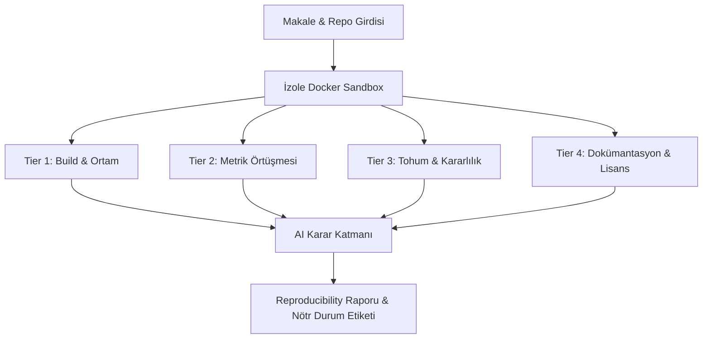

# Repro Radar 🛰️

[-blue.svg)](#)
[](#)
[](LICENSE)
[](docs/methodology.md)

**Repro Radar**, bilimsel makale ve açık kaynak kod çiftlerini izole sandbox ortamlarında test ederek **Reproducibility Skoru** (0–100) üreten ve **AI Karar Katmanı** ile doğrulama süreçlerini otomatikleştiren bağımsız bir doğrulama motorudur.

---

## 📌 Problem Tanımı

Yapay zekâ ve veri bilimi literatüründe yayımlanan çalışma sayısı katlanarak artarken, bağımsız araştırma gruplarının ve uygulayıcıların bu sonuçları yeniden üretme (**reproducibility**) kapasitesi geride kalmaktadır.

- **Eksik veya Sabitlenmemiş Bağımlılıklar:** Yıllar veya aylar sonra çalışmayan kütüphane sürümleri.
- **Rastgele Tohum (Seed) Kırılganlığı:** Yalnızca tek bir şanslı tohumda elde edilen ve tekrarlanamayan metrik iddiaları.
- **Kapalı/Eksik Ortamlar:** Kodun donanım veya özel işletim sistemi bağımlılıkları nedeniyle derlenememesi.
- **Doğrulama Eforunun Yüksekliği:** Hakemlerin ve araştırmacıların kodları manuel olarak kurup test edecek zamanının olmaması.

Repro Radar, bu krize karşı **otomatize, şeffaf ve çok kademeli** bir değerlendirme standardı sunar.

---

## 🏗️ Sistem Mimarisi

Sistem iki temel direk üzerine inşa edilmiştir:



### 1. Dört Kademeli (4-Tier) Skorlama Rubriği

| Kademe | Ağırlık | Kapsam | Çıktı / Kriter |
| :--- | :---: | :--- | :--- |
| **Tier 1: Build & Çalıştırma** | **%35** | Depo klonlama, kütüphane kurulumu, script çalıştırma | Hatasız Exit Code 0 |
| **Tier 2: Sonuç Örtüşmesi** | **%35** | Makale iddiaları ile üretilen metriklerin karşılaştırılması | %5 Tolerans Aralığı |
| **Tier 3: Kararlılık (Seed)** | **%15** | Çoklu tohum (multi-seed) altındaki varyans denetimi | Varyasyon Katsayısı (CV) |
| **Tier 4: Artefakt & Lisans** | **%15** | Lisans açıklığı, README, gereksinim dosyaları, loglar | OSI Lisans Uyumu |

### 2. AI Karar Katmanı ve Nötr Dil İlkesi

Repro Radar, araştırmacıları suçlayıcı ifadelerden kesinlikle kaçınır. AI Karar Katmanı, sistem loglarını ve metrik sapmalarını inceleyerek yalnızca nesnel durumlar tanımlar:
- **`Doğrulandı`**: Tüm kademeler yüksek başarıyla tekrarlandı.
- **`Kısmen Doğrulandı`**: Kod çalıştı, ana iddiaların çoğu tolerans içinde.
- **`İncelenmeli`**: Kod sorunsuz derlendi ancak sonuçlar belirgin şekilde farklı; donanım/veri sürümü farkı olabilir.
- **`Tekrarlanamadı`**: Derleme veya ortam hataları nedeniyle kod koşulamadı.

---

## 🚀 Kurulum ve Yerel Çalıştırma

### Gereksinimler
- Python 3.10+ (Önerilen: Python 3.11)
- Git

### 1. Depoyu Klonlama ve Dizin Girişi
```bash
git clone https://github.com/your-org/repro-radar.git
cd repro-radar
```

### 2. Sanal Ortam Oluşturma ve Paket Kurulumu
```bash
# Sanal ortam oluşturma
python -m venv .venv

# Ortamı aktif etme (Windows PowerShell)
.venv\Scripts\Activate.ps1

# Ortamı aktif etme (Linux/macOS)
# source .venv/bin/activate

# Bağımlılıkları kurma
pip install -r requirements.txt
```

### 3. Veritabanını Başlatma ve Makale Tohumlama
```bash
python cli.py init-db
```
Bu komut `data/schema.sql` şemasını kullanarak `data/repro_radar.db` SQLite veritabanını oluşturur ve `data/seed_papers.json` içerisindeki 18 makaleyi otomatik olarak veritabanına aktarır.

### 4. Makaleleri Listeleme ve İnceleme
```bash
python cli.py list-papers
```

### 5. Örnek Skorlama ve Teşhis Raporu Koşumu
```bash
python cli.py score paper_001
```

### 6. Testleri Çalıştırma
```bash
pytest tests/ -v
```

---

## 🎯 Hafta 1 Kapsamı: Hedef Makale Kümesi

Hafta 1 kapsamında, ağır GPU istemeyen ve standart bir CPU veya hafif Docker konteynerinde 2–10 dakikada çalışabilecek **"Tabular Machine Learning & Light NLP Benchmarks"** alt-alanı seçilmiştir:
- **Kapsam:** Scikit-learn, XGBoost, LightGBM, CatBoost, TabPFN, DistilBERT linear probing ve FastSK tabanlı güncel bildiriler (2021–2024).
- **Veri Seti:** 18 adet açık lisanslı (MIT, Apache-2.0, BSD), doğrulanmış GitHub deposu ve beklenen metrik iddiaları (`data/seed_papers.json`).

---

## 🛡️ Güvenlik, İzolasyon ve Etik İlkeleri

1. **İzole Sandbox Denetimi:** Üçüncü taraf kodlar asla doğrudan yerel işletim sisteminde çalıştırılmaz; bellek, CPU ve ağ kısıtlamalarına sahip geçici Docker konteynerlerinde yürütülür.
2. **Nötr ve Yapıcı İletişim:** Bir makalenin kodunun çalışmaması durumunda sübjektif yargılarda bulunulmaz; donanım, kütüphane ve çevre farkları gözetilerek **"İncelenmeli"** etiketi ve detaylı hata dökümü sağlanır.
3. **Yalnızca Açık Lisanslı Çalışmalar:** Yalnızca açık kaynak lisansı (MIT, Apache-2.0, BSD vb.) içeren depolara yönelik değerlendirmeler yapılır.

---

## 📂 Dizin Yapısı

```
repro-radar/
├── .gitignore               # Python, SQLite ve sanal ortam filtreleri
├── LICENSE                  # MIT Açık Kaynak Lisansı
├── README.md                # Proje dokümantasyonu ve rehberi
├── requirements.txt         # Pydantic, SQLAlchemy, Pandas, Pytest vb.
├── cli.py                   # Komut satırı arayüzü ve yönetim scripti
├── src/
│   ├── __init__.py          # Paket başlatıcı
│   ├── config.py            # Yol tanımları, ağırlıklar ve toleranslar
│   ├── database.py          # SQLite bağlantısı, CRUD ve tohumlama
│   ├── scoring.py           # 4-Tier reproducibility skorlama motoru
│   └── models.py            # Pydantic ve SQLAlchemy ORM şemaları
├── data/
│   ├── schema.sql           # SQLite ilişkisel tablo tanımları
│   └── seed_papers.json     # 18 adet Tabular ML & Light NLP makale seti
├── docs/
│   ├── methodology.md       # Skorlama rubriği, formüller ve etik ilkeler
│   └── project_roadmap.md   # 7 haftalık ayrıntılı kilometre taşları
└── tests/
    ├── __init__.py
    ├── test_database.py     # Veritabanı ve tohumlama testleri
    ├── test_models.py       # Pydantic ve ORM model doğrulama testleri
    └── test_scoring.py      # Tier 1-4 skorlama mantığı testleri
```

---

## 📄 Lisans

Bu proje [MIT Lisansı](LICENSE) altında geliştirilmektedir.
