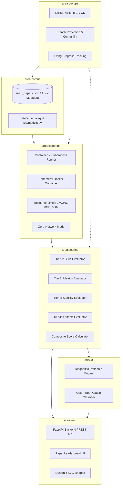

# Repro Radar — Architecture & Design Decisions

> System constraints, component structure, data model contracts, and decision records mapped to the 6 projectflow areas.

---

## 1. System Topology across 6 Areas

---

## 2. Area Boundaries & Component Layering

1. **`area:corpus` (`data/`, `src/models.py`, `src/database.py`)**:
   - Manages research paper catalog, metadata ingestion, validation models, and SQLite relational persistence.
   - Pydantic v2 validates all paper inputs; SQLAlchemy models define relational schema (`papers`, `runs`, `claims`, `scores`).

2. **`area:sandbox` (`src/sandbox/`, `docker/`)**:
   - Dual-mode architecture: `DockerRunner` for full container cgroup & network isolation; `LocalProcessRunner` as local fallback.
   - Strict execution budget: 2 vCPU cores, 8GB memory ceiling, 600-second hard timeout.

3. **`area:scoring` (`src/scoring.py`)**:
   - Pure functional evaluation engine computing Tier 1 (35%), Tier 2 (35%), Tier 3 (15%), Tier 4 (15%).
   - Tolerance evaluation:
     $$\text{Relative Error} = \frac{|\text{Reproduced} - \text{Claimed}|}{\max(|\text{Claimed}|, 10^{-6})}$$
     - Exact match ($\le 5\%$ error): 1.0 pt
     - Partial match ($\le 10\%$ error): 0.5 pt
     - Diverged ($> 10\%$ error): 0.0 pt

4. **`area:ai` (`src/ai/`)**:
   - AI Decision Layer providing neutral status assignments (`Verified`, `Partially Verified`, `Needs Review`, `Failed`).
   - Generates objective, evidence-based diagnostic explanations for reviewers.

5. **`area:web` (`src/web/`)**:
   - REST endpoints for paper inspection and evaluation dispatch.
   - Embeddable markdown/SVG badges and downloadable audit reports.

6. **`area:devops` (`.github/`, `scripts/`, `docs/`)**:
   - Projectflow guardrails, living documents (`docs/`), PR templates, and GitHub Actions CI automation.
