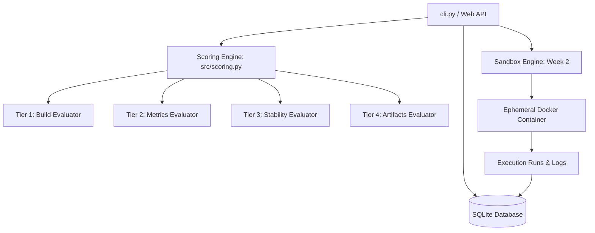

# Repro Radar — Architecture & Design Decisions

> System constraints, component structure, data model contracts, and decision records.

---

## 1. System Structure

---

## 2. Component Boundaries & Layering

1. **`src/config.py`**:
   - Single source of truth for paths, scoring weights, tolerance thresholds, and status labels.
   - Independent of all other modules.

2. **`src/models.py`**:
   - **SQLAlchemy ORM (`PaperORM`, `RunORM`, `ClaimORM`, `ScoreORM`)**: Defines database table structures, relationships, and cascade behaviors.
   - **Pydantic v2 Models (`PaperCreate`, `RunCreate`, `ClaimCreate`, `ScoreBreakdown`, `ScoreCreate`)**: Enforces input validation, constraints (e.g. valid URLs, year between 1990–2100), and serialization.

3. **`src/database.py`**:
   - Manages connection lifecycle (`get_engine()`, `get_session()`).
   - Implements idempotent DDL initialization (`init_db()`) and paper seeding (`seed_database()`).

4. **`src/scoring.py`**:
   - Pure functional and class-based evaluators without side effects.
   - Receives execution results and returns structured `ScoreBreakdown` + diagnostics.

5. **`cli.py`**:
   - Orchestration interface for operator workflows (`init-db`, `list-papers`, `inspect`, `score`).

---

## 3. Data Model Constraints

- **Foreign Keys:** Enforced via `PRAGMA foreign_keys = ON;`.
- **Cascading Deletes:** Deleting a `paper` record cascades and deletes associated `runs`, `claims`, and `scores`.
- **Unique Constraints:** `paper_id` is unique across all tables; `scores.paper_id` is unique (1-to-1 relationship with paper).
- **Metric Tolerance:**
  $$\text{Relative Error} = \frac{|\text{Reproduced} - \text{Claimed}|}{\max(|\text{Claimed}|, 10^{-6})}$$
  - Full match: $\text{Relative Error} \le 5\%$
  - Partial match: $\text{Relative Error} \le 10\%$
  - Diverged: $\text{Relative Error} > 10\%$
