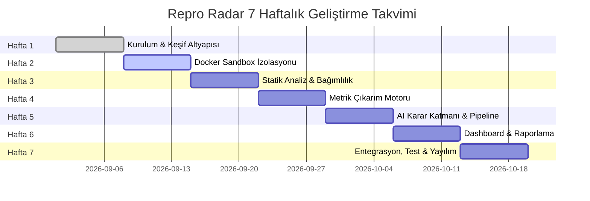

# Repro Radar: 7 Haftalık Proje Yol Haritası (Roadmap)

Bu doküman, "Repro Radar: Otomatize Bilimsel Kod Doğrulama ve Reproducibility Skorlama Sistemi"nin 7 haftalık geliştirme sürecini, her haftanın kilometre taşlarını (milestones) ve somut görev listelerini (tasks) tanımlar.

---

---

## Hafta 1: Kurulum ve Keşif Altyapısı (Tamamlandı ✅)
- **Hedef:** Projenin çekirdek iskeletini, veri şemasını, hedef makale setini ve 4 kademeli skorlama mantığını kurmak.
- **Görevler:**
  - [x] Repo mimarisini ve dizin hiyerarşisini kurma (`src/`, `data/`, `docs/`, `tests/`).
  - [x] `schema.sql` ile SQLite ilişkisel veritabanı şemasını oluşturma (`papers`, `runs`, `claims`, `scores`).
  - [x] SQLAlchemy ORM ve Pydantic doğrulama şemalarını yazma (`src/models.py`).
  - [x] 18 makale içeren "Tabular Machine Learning & Light NLP" tohum veri setini hazırlama (`data/seed_papers.json`).
  - [x] Otomatik veritabanı başlatma ve tohumlama (seeding) altyapısını yazma (`src/database.py`).
  - [x] 4 Kademeli (Tier 1-4) reproducibility skorlama motorunu ve nötr durum sınıflandırmasını geliştirme (`src/scoring.py`).
  - [x] Kapsamlı metodoloji ve etik ilkeleri dokümantasyonu (`docs/methodology.md`).
  - [x] Birim testleri yazıp doğrulama (`tests/`).

---

## Hafta 2: Docker Sandbox ve İzolasyon Motoru
- **Hedef:** Harici depoların ana sistemden tamamen yalıtılmış, kısıtlı kaynaklara sahip Docker konteynerlerinde çalıştırılması.
- **Görevler:**
  - [ ] Standartlaştırılmış Python 3.10 / 3.11 tabanlı Dockerfile ve çalışma imajlarının hazırlanması.
  - [ ] Kaynak sınırlandırma altyapısı: CPU limitleri (2 çekirdek), RAM kotası (maks. 8GB), timeout denetimi (600s).
  - [ ] Ağ izolasyonu kuralları (yalnızca paket indirme aşamasında açık, kod çalıştırma anında kapalı ağ modu).
  - [ ] Konteyner yaşam döngüsü yöneticisi (`src/sandbox/runner.py`): Başlatma, log akışı, exit code takibi ve temizlik.
  - [ ] Çoklu tohum (multi-seed) tekrarlama altyapısının sandbox'a entegre edilmesi.

---

## Hafta 3: Statik Kod Analizi ve Bağımlılık Ayrıştırıcı
- **Hedef:** Klonlanan depolardaki eksik bağımlılıkları, donanım gereksinimlerini ve giriş scriptlerini çalıştırma öncesinde tespit etmek.
- **Görevler:**
  - [ ] Python AST (Abstract Syntax Tree) tarayıcısı ile örtük import edilen kütüphaneleri çıkarma.
  - [ ] `requirements.txt`, `setup.py`, `pyproject.toml` ve `environment.yml` dosyalarını ayrıştıran çoklu parser.
  - [ ] Sabitlenmemiş (unpinned) sürümler için akıllı sürüm çözümleyici (dependency solver).
  - [ ] CUDA/GPU bağımlılıklarını tespit eden ve CPU uyumluluk bayraklarını (`--cpu`, `device='cpu'`) otomatik enjekte eden modül.
  - [ ] Hedef script (entrypoint) tespit algoritması (`main.py`, `eval.py`, `run.py`, `test.py`).

---

## Hafta 4: Metrik Çıkarım Motoru (Metric Extraction Engine)
- **Hedef:** Konsol çıktısı (`stdout`), JSON/CSV logları veya model artefaktlarından makale iddialarına karşılık gelen sayısal sonuçları ayrıştırmak.
- **Görevler:**
  - [ ] Regex tabanlı metrik ayrıştırıcı (`accuracy: 0.85`, `AUC = 0.912`, `Loss: 0.42` kalıpları).
  - [ ] Scikit-learn, PyTorch ve LightGBM standart değerlendirme çıktı formatlarının taranması.
  - [ ] Yapılandırılmamış serbest konsol logları için yerel LLM destekli metrik eşleştirici fallback katmanı.
  - [ ] Ayrıştırılan metriklerin `claims` tablosuna kaydedilmesi ve tolerans farklarının hesaplanması.

---

## Hafta 5: AI Karar Katmanı ve Otomatize Değerlendirme Pipeline'ı
- **Hedef:** Çalıştırma sonuçları, metrik sapmaları ve sistem günlüklerini birleştirerek tarafsız bir inceleme raporu üreten zekâ katmanı.
- **Görevler:**
  - [ ] Tier 1, 2, 3 ve 4 değerlendiricilerinin tek bir `PipelineController` altında orkestrasyonu.
  - [ ] Hata teşhis motoru: Çökme (crash) nedenlerini sınıflandırma (bellek yetersizliği, eksik veri seti, paket çakışması).
  - [ ] Nötr durum atama motoru ("İncelenmeli" vs "Kısmen Doğrulandı" ayrımı).
  - [ ] Otomatik açıklama (diagnostic rationale) üreten karar şablonları.

---

## Hafta 6: Web Dashboard ve Doğrulama Raporu Üreticisi
- **Hedef:** Değerlendirilen makalelerin arandığı, skorların karşılaştırıldığı interaktif bir panel ve dışa aktarılabilir doğrulama rozetleri (badges).
- **Görevler:**
  - [ ] FastAPI tabanlı REST API (`/papers`, `/scores`, `/runs/{id}`).
  - [ ] Streamlit veya hafif modern Web arayüzü (skor tabloları, filtreler, metrik grafikler).
  - [ ] GitHub README rozet üreteci (örn. `![Repro Radar: 92/100 Verified]`).
  - [ ] Makale bazında PDF veya Markdown doğrulama raporu indirme fonksiyonu.

---

## Hafta 7: Uçtan Uca Doğrulama, Topluluk Protokolü ve Yayınlama
- **Hedef:** 18 makalenin tamamında pilot testlerin koşulması, dokümantasyonun nihayete erdirilmesi ve açık kaynak sürümünün duyurulması.
- **Görevler:**
  - [ ] Tohum makale setinde (18 paper) tam sandbox doğrulama testlerinin yürütülmesi.
  - [ ] Topluluk katkı kuralları (`CONTRIBUTING.md`) ve yeni makale ekleme rehberi.
  - [ ] CI/CD pipeline'ı (GitHub Actions üzerinden otomatik test koşumu).
  - [ ] V1.0 sürüm duyurusu ve teknik blog/bildiri özeti.
