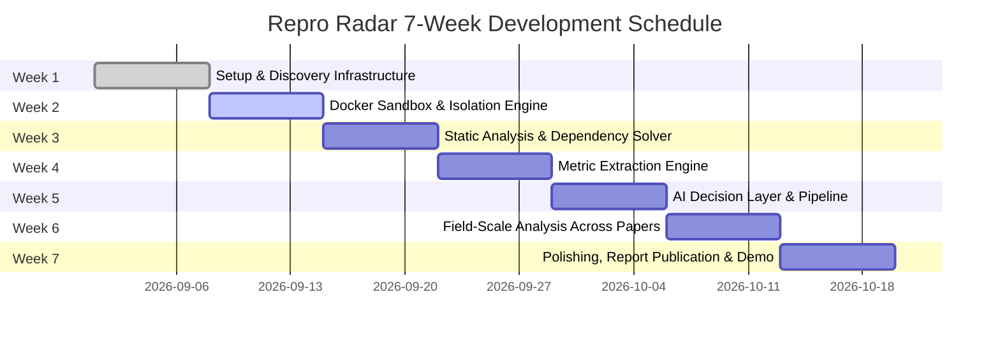

# Repro Radar: 7-Week Project Roadmap

This document defines the 7-week development schedule, milestones, and concrete task breakdowns for the Repro Radar automated replication and verification platform.

---

---

## Week 1: Setup & Discovery Infrastructure (Completed ✅)
- **Objective:** Establish the core project skeleton, relational data schema, target seed paper dataset, and 4-tier reproducibility scoring engine.
- **Tasks:**
  - [x] Repository architecture & directory hierarchy (`src/`, `data/`, `docs/`, `tests/`).
  - [x] SQLite relational schema via `schema.sql` (`papers`, `runs`, `claims`, `scores`).
  - [x] SQLAlchemy ORM and Pydantic v2 validation models (`src/models.py`).
  - [x] Curate "Tabular Machine Learning & Light NLP" seed dataset (`data/seed_papers.json`). Links, repositories, licenses, and pinned scripts are checked by `scripts/verify_corpus.py`; claim values are not yet verified (see `docs/CORPUS_VERIFICATION.md`).
  - [x] Automated database initialization and seeding engine (`src/database.py`).
  - [x] 4-Tier reproducibility scoring engine and neutral status classifier (`src/scoring.py`).
  - [x] Methodology and ethical standards documentation (`docs/methodology.md`).
  - [x] Comprehensive unit tests (24/24 passing) (`tests/`).

---

## Week 2: Docker Sandbox & Isolation Engine
- **Objective:** Execute third-party repositories in ephemeral, resource-constrained container environments isolated from the host machine.
- **Tasks:**
  - [ ] Standardized Python 3.11 base Dockerfile and runtime images (`docker/Dockerfile.sandbox`).
  - [ ] Resource quotas: CPU limits (2 vCPUs), memory caps (8GB max), execution timeout (600s).
  - [ ] Network isolation policy (network permitted during dependency install, disabled with `--network none` during execution).
  - [ ] Container lifecycle runner (`src/sandbox/runner.py`): Launch, log streaming, exit code capture, and cleanup.
  - [ ] Multi-seed execution harness integrated with sandbox and SQLite `runs` table.

---

## Week 3: Static Code Analysis & Dependency Solver
- **Objective:** Pre-analyze cloned repositories to detect implicit dependencies, hardware requirements, and entrypoint scripts before execution.
- **Tasks:**
  - [ ] Python AST (Abstract Syntax Tree) scanner to detect undeclared package imports.
  - [ ] Multi-format manifest parser (`requirements.txt`, `setup.py`, `pyproject.toml`, `environment.yml`).
  - [ ] Intelligent dependency solver for unpinned version constraints.
  - [ ] GPU-to-CPU compatibility adapter (injecting `--cpu`, `device='cpu'` flags).
  - [ ] Entrypoint script heuristic detector (`main.py`, `eval.py`, `run.py`, `test.py`).

---

## Week 4: Metric Extraction Engine
- **Objective:** Parse console logs (`stdout`), structured outputs (JSON/CSV), and model checkpoints to extract empirical values matching paper claims.
- **Tasks:**
  - [ ] Regex-based metric extractor (`accuracy: 0.85`, `AUC = 0.912`, `Loss: 0.42`).
  - [ ] Standardized evaluation parsers for Scikit-learn, PyTorch, and LightGBM output formats.
  - [ ] Local LLM fallback parser for unstructured free-text console logs.
  - [ ] Store extracted metrics in `claims` table and compute relative errors.

---

## Week 5: AI Decision Layer & Automated Pipeline
- **Objective:** Synthesize execution logs, metric discrepancies, and system traces into an objective diagnostic report.
- **Tasks:**
  - [ ] Orchestrate Tier 1, 2, 3, and 4 evaluators under a unified `PipelineController`.
  - [ ] Root-cause diagnostic engine (classify out-of-memory, missing data, version conflict errors).
  - [ ] Automated decision rationale templates.
  - [ ] Structured report generation (Markdown & JSON).

---

## Week 6: Field-Scale Analysis (Reproducibility Study Across Papers)
- **Objective:** Conduct a systematic, field-scale reproducibility study across the evaluated paper corpus to extract statistical patterns, reproducibility correlations, and macro benchmarks.
- **Tasks:**
  - [ ] Execute automated batch evaluation across the entire benchmark paper corpus.
  - [ ] Statistical factor analysis: correlate reproducibility rates with factors (open-source licenses, framework choices, pinned requirements, random seed documentation).
  - [ ] Macro reproducibility scorecard: aggregate cross-paper metrics (mean tier scores, failure mode distributions, hardware discrepancy indices).
  - [ ] REST API endpoints & paper leaderboard for cross-paper comparison.
  - [ ] Dynamic SVG reproducibility badges for repository READMEs (`![Repro Radar: 95/100 Verified]`).

---

## Week 7: Polishing, Report Publication & Demo Video
- **Objective:** Finalize project presentation, publish the comprehensive empirical findings report/paper, produce a demonstration video, and deliver the production release.
- **Tasks:**
  - [ ] Produce end-to-end demo video showcasing CLI, isolated sandbox execution, and automated AI diagnostics.
  - [ ] Author comprehensive reproducibility findings report / blog paper detailing empirical results and failure modes.
  - [ ] Polish developer documentation, API references, and open-source contribution guide (`CONTRIBUTING.md`).
  - [ ] Automated CI/CD pipeline via GitHub Actions and release tagging (`v1.0.0`).
  - [ ] Final portfolio presentation deck and project defense deliverables.
